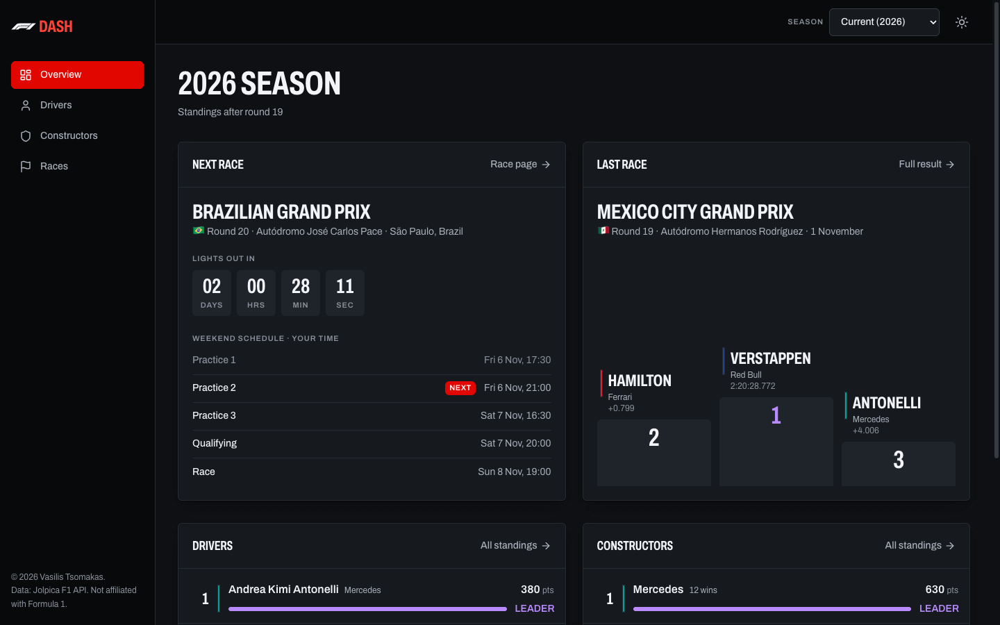
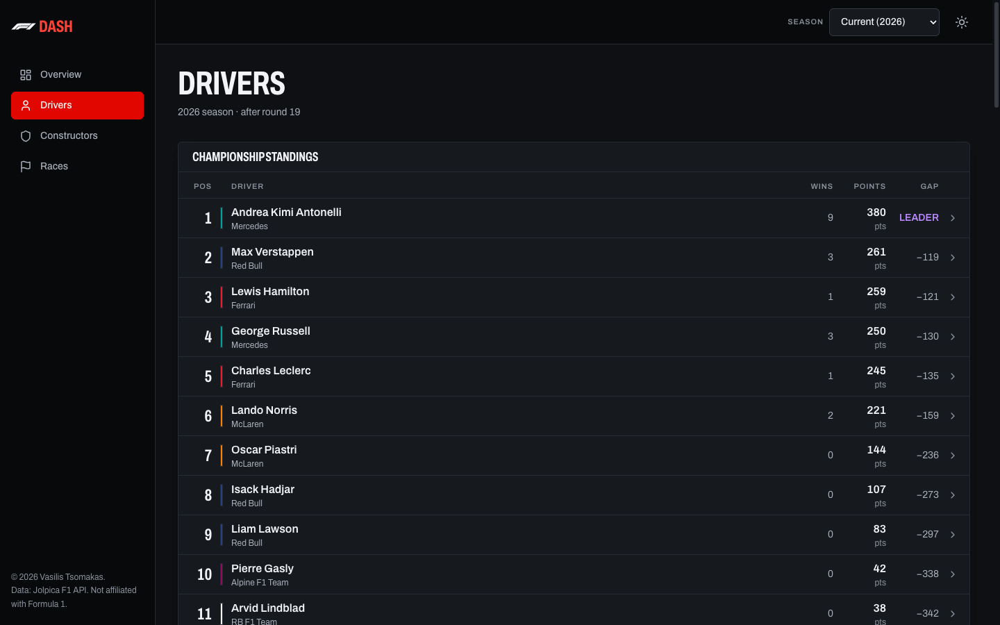
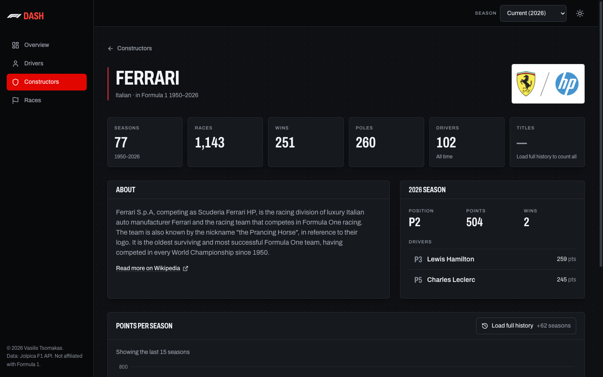
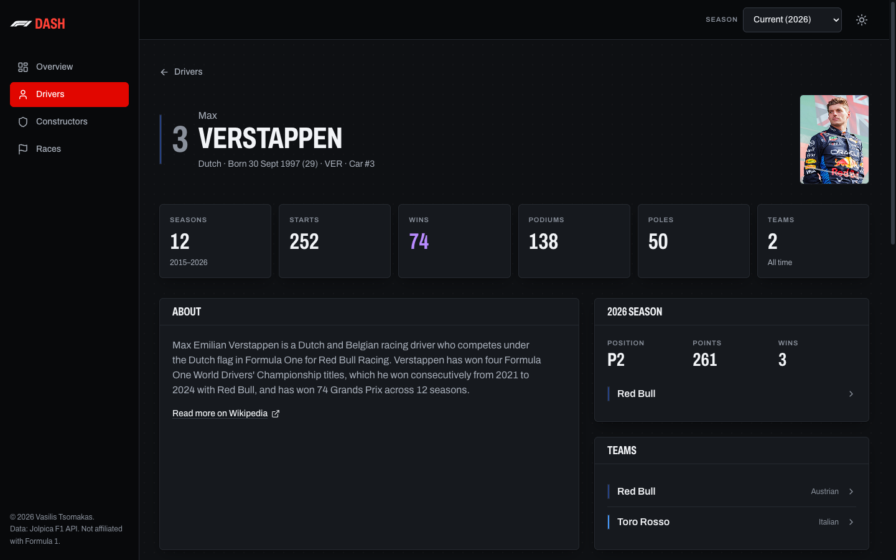
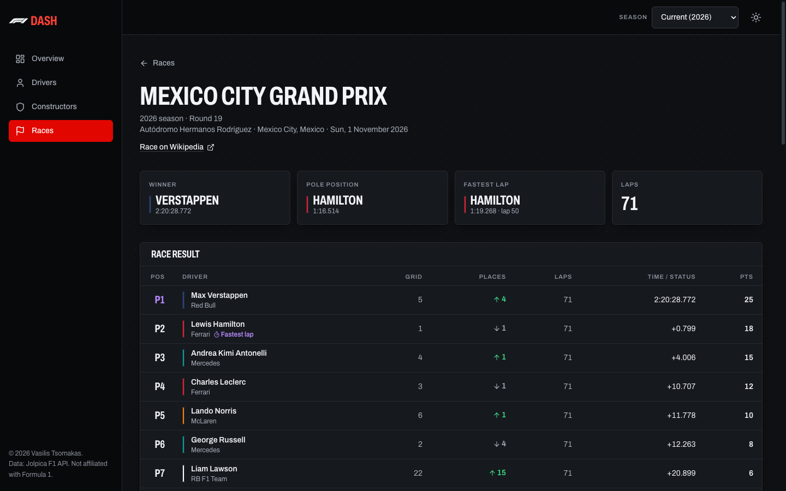
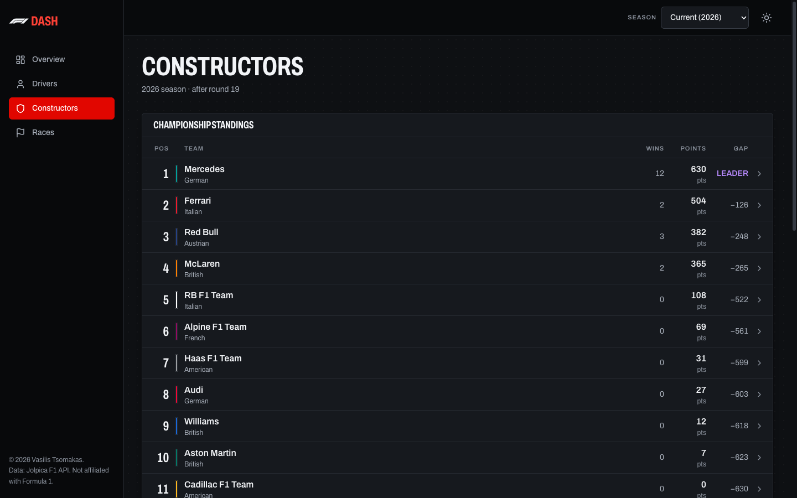
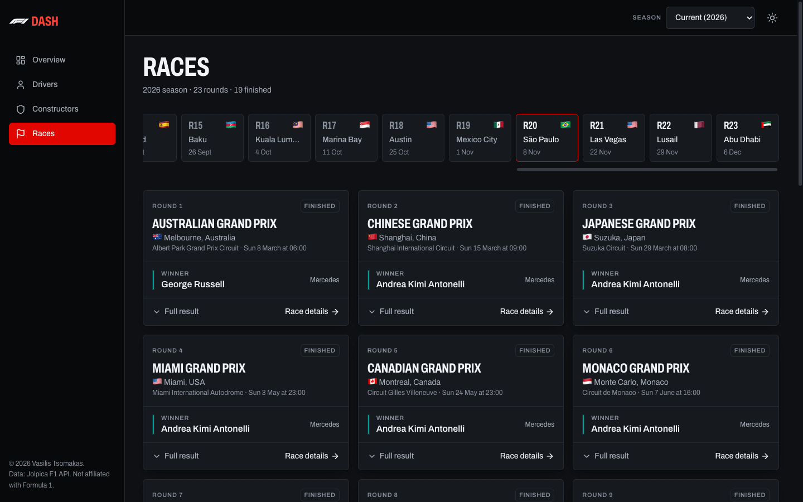
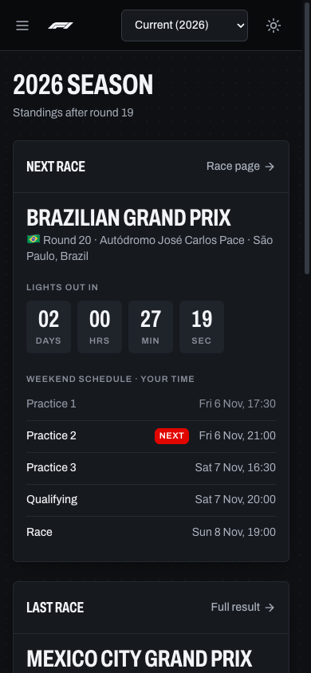
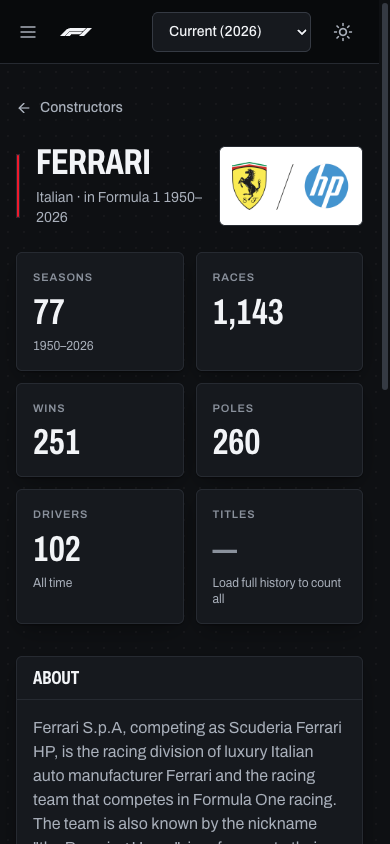
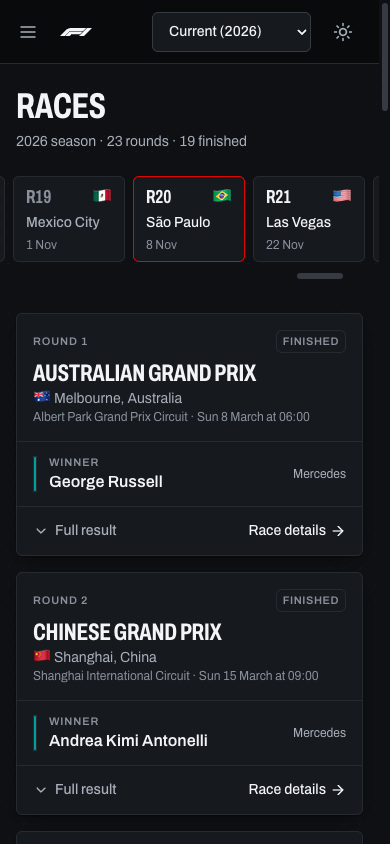

# F1 Dashboard

A Formula 1 fan dashboard for any season, styled like a broadcast timing tower: championship standings, the race calendar and results, and history pages for every constructor and driver.



## Features

- **Overview:** live countdown to the next race with the weekend schedule in your local time, last-race podium, and top-5 drivers and constructors with gap-to-leader bars.
- **Drivers:** timing-tower standings plus the grid grouped by team, with search and a team filter (`?team=`).
- **Driver profiles** (`/drivers/:id`): career stats (seasons, starts, wins, podiums, poles, teams), Wikipedia bio and photo, all-time teams, and a race-by-race results table for the selected season.
- **Constructors:** standings and team cards linking to each team's profile.
- **Constructor profiles** (`/constructors/:id`): career stats, Wikipedia intro and logo, current season and drivers, and a points-per-season chart with championship seasons highlighted. The last 15 seasons load first; full history loads on request through a throttled queue and is cached locally.
- **Races:** calendar strip with finished / next / upcoming status, race cards with winner and expandable full result.
- **Race pages** (`/races/:season/:round`): race result, sprint result and qualifying (Q1–Q3), with winner, pole, fastest lap and laps.
- **Season selector:** every page works for any season from 1950 on, kept in the URL (`?season=2021`).
- **Dark and light themes**, responsive down to phone width with a drawer menu.
- **Motion with purpose:** standings rows wipe in like a broadcast graphic, gap bars fill, podium steps rise, the active nav block slides, filtered cards glide into place. All of it respects `prefers-reduced-motion`.
- **Accessible:** keyboard navigable, visible focus, WCAG 2.2 AA contrast in both themes, team colors always paired with names.

## Tech Stack

- **React 19** + **Vite 7**
- **Tailwind CSS v4** (design tokens in `src/index.css`, documented in `DESIGN.md`)
- **TanStack React Query** for caching and retries
- **React Router 7**
- **Recharts** for the points-per-season chart
- **Motion** for route, layout and nav animations
- **[Jolpica F1 API](https://github.com/jolpica/jolpica-f1)** (Ergast-compatible) for data, **Wikipedia REST API** for intros and images

Jolpica is rate limited (about 4 requests/second and 500/hour), so the app batches season results into paginated calls, throttles history loads and caches aggressively.

## Getting started

```bash
npm install
npm run dev      # http://localhost:5173
npm run build
npm run lint
```

No API keys or environment variables are needed.

## Preview

| Drivers | Constructor profile |
| --- | --- |
|  |  |

| Driver profile | Race page |
| --- | --- |
|  |  |

| Constructors | Races |
| --- | --- |
|  |  |

### Mobile

<p>
  
  
  
</p>

---

Not affiliated with Formula 1. Data from the Jolpica F1 API and Wikipedia.
